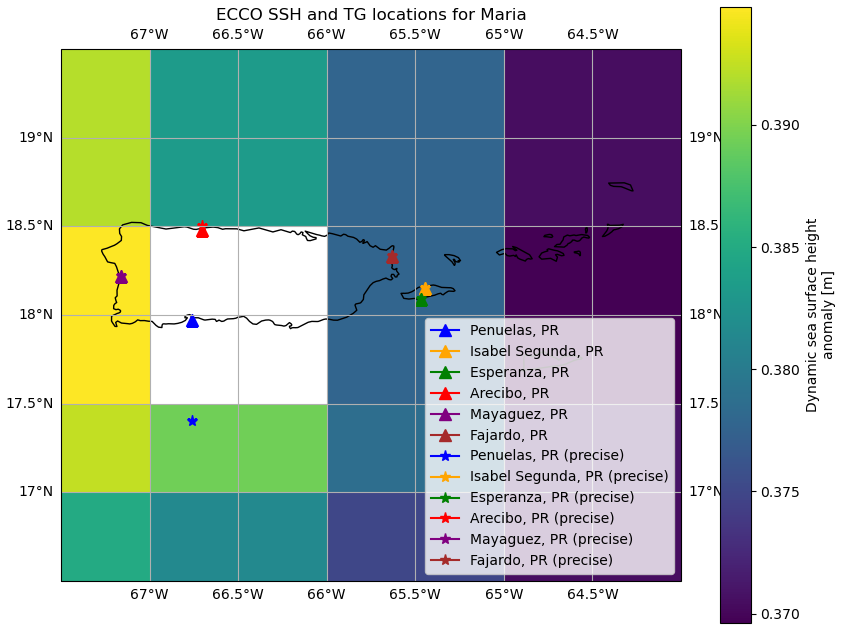
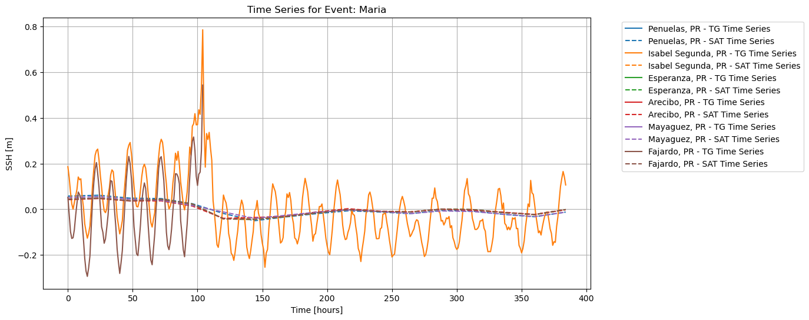
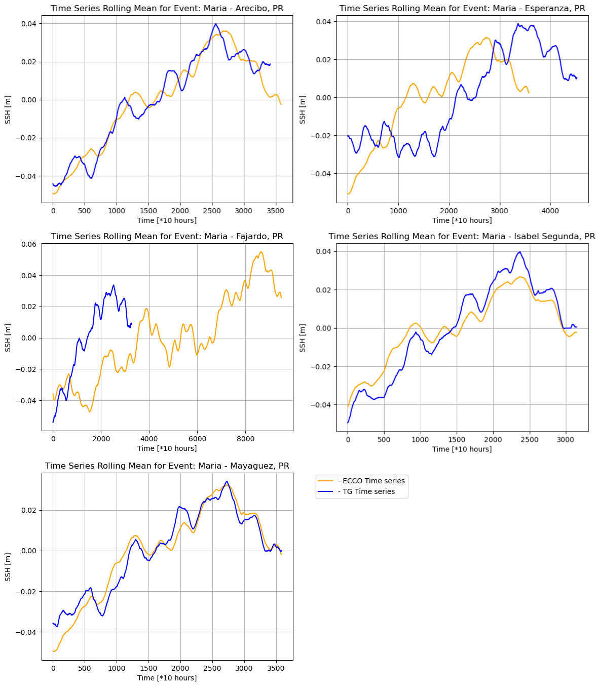

### Description

This project compares sea surface height (SSH) data from the ECCO ocean reanalysis model with in situ tide-gauge measurements from Puerto Rico during Hurricane Maria. It shows how well satellite-based estimates track coastal observations during an extreme event and where the two datasets diverge.

*Puerto Rico tide gauge locations affected by Hurricane Maria*

*Time series ECCO and UHSLC SSH comparison during Hurricane Maria (normalized, resampled)*

*Time series SSH rolling mean comparisons*

### What it does

- Compares ECCO sea surface height estimates with six Puerto Rico tide gauges
- Evaluates agreement during Hurricane Maria and over the surrounding record
- Visualizes time-series and correlation results across multiple locations
- Uses Bland–Altman analysis to assess measurement differences and agreement

### How it works

The workflow downloads ECCO daily SSH data and tide-gauge observations, aligns them by location and time, and compares the two series across the same event window. Correlation and agreement metrics are calculated for each gauge, and the results are visualized in time-series and difference plots. This assesses the accuracy of satellite estimates for SSH measurement during extreme weather conditions.

### Tech

- Python
- xarray
- pandas
- NumPy
- SciPy
- Matplotlib

### Links

- [Demo](https://www.youtube.com/watch?v=_mT-hI692f8)
- [Repo](https://github.com/FranckPrts/CMA_2023_Project/tree/main/CISP%20Micropublication)
- [Blog](https://faithhunja.github.io/blog/2024-06-20-ecco-vs-tgs-affected-by-hurricane-maria/)
