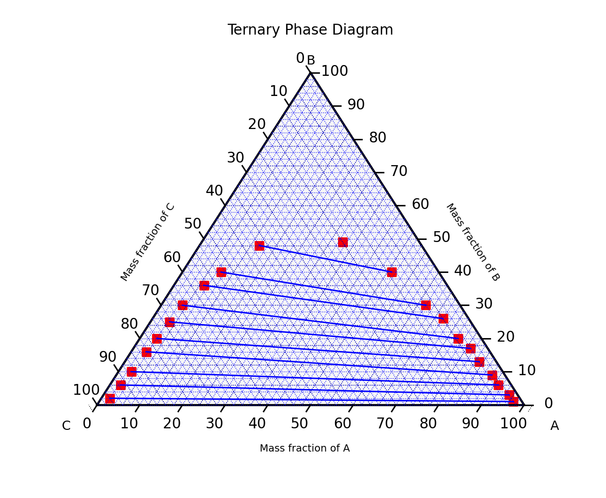

### Description

Fqlearn ternary plotting tool helps visualize and analyze three-component systems by plotting compositions on a ternary diagram, drawing equilibrium lines between compositions, and smoothing those curves for easier interpretation. The library is designed for thermodynamics and mass-transfer workflows where relationships between three variables need to be shown clearly in a compact two-dimensional view.

*Equilibrium lines joining two compositions*

### What it does

- Plots three-component composition data on a ternary phase diagram
- Connects related compositions with equilibrium lines
- Interpolates and smooths those lines for clearer visual analysis
- Supports comparison of left and right equilibrium branches in a single diagram

### How it works

The plotting workflow starts with normalized composition tuples and sorts them into a consistent order before rendering. Equilibrium relationships are drawn between matched points, then cubic-spline interpolation smooths rough curves into a more interpretable shape. This keeps the visual output accurate while making complex phase relationships easier to inspect and compare.

### Technologies used

- Python
- Matplotlib
- python-ternary
- NumPy
- SciPy

### Links

- [Repo](https://github.com/osl-pocs/fqlearn/blob/main/src/fqlearn/ThreeComponent.py)
- [Blog](https://opensciencelabs.org/blog/fqlearn-ternary-plot/)
