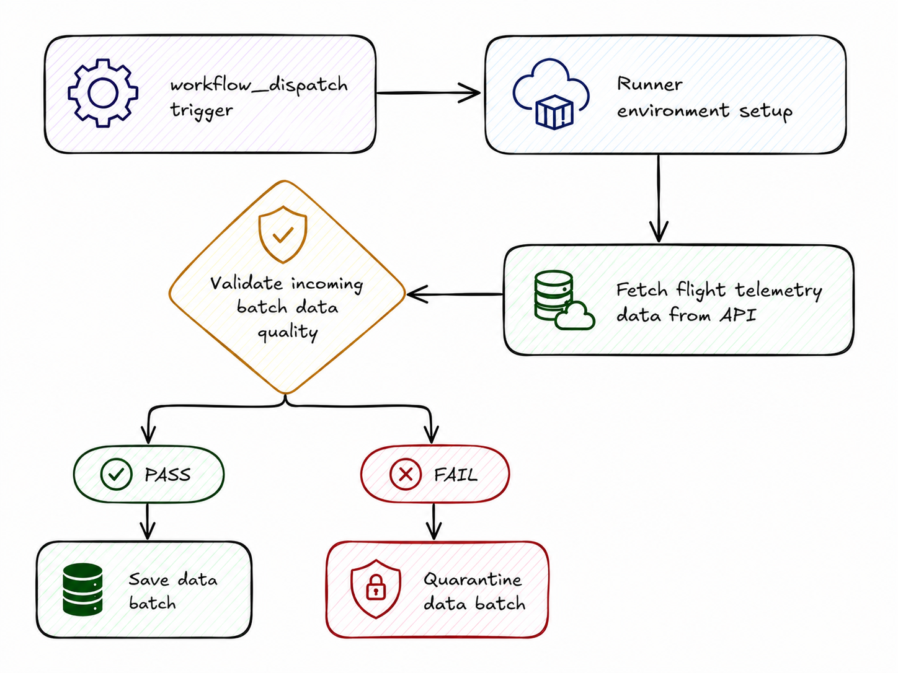

### Description

This project is a self-orchestrated data pipeline that pulls live aircraft telemetry from the OpenSky API, validates each batch against a defined data contract, and only stores records that pass the checks. It is built to catch bad or incomplete data before it contaminates the downstream dataset, with the workflow running using GitHub Actions and the data quality managed using Great Expectations.

*The workflow diagram*

### What it does

- Triggers a workflow to fetch flight telemetry from the OpenSky API
- Runs data quality validation on the incoming batch
- Uses validation results to decide whether data gets ingested or quarantined

### How it works

A GitHub Actions workflow sets up the environment, fetches flight telemetry, and passes the resulting batch to a Great Expectations validation step. The validation result determines whether the workflow continues to persist the data or routes the data to quarantine. The persisted data is appended to a CSV file.

<figure class="space-y-2">
  <video controls playsinline class="w-full rounded-lg">
    <source src="/project videos/flight-telemetry-demo.mp4" type="video/mp4" />
  </video>
  <figcaption class="font-serif text-base leading-7 text-left text-current"><em>Workflow run demo</em></figcaption>
</figure>

### Tech

- Python
- GitHub Actions
- pandas
- Great Expectations

### Links

- [Repo](https://github.com/faithhunja/flight-data-quality-and-ingestion-pipeline)
