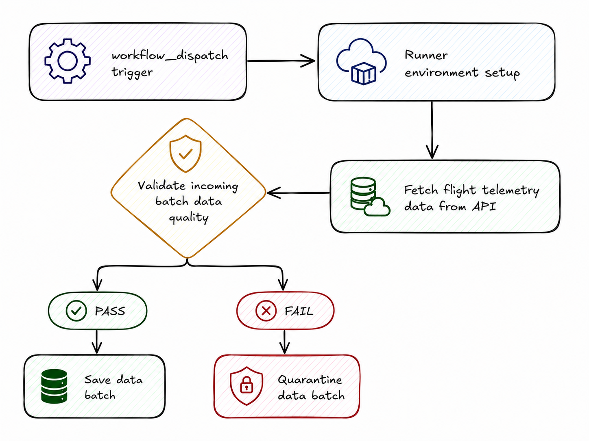
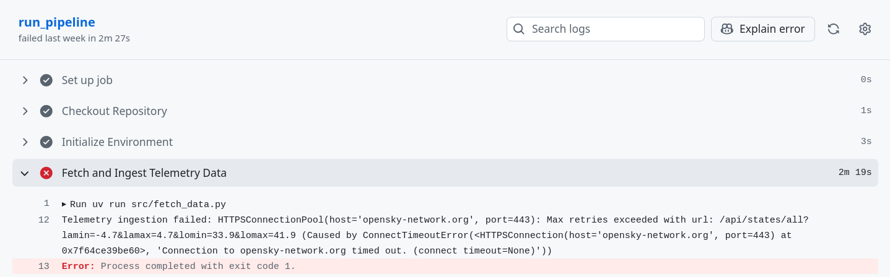

## Introduction

1. Hook: The problem (rewrite, keep short)

    Open with the "silent failure" contrast (loud crash vs. quiet corruption) — this is the strongest part of the original, keep it but trim it to 3-4 sentences.
    End with one sentence stating what you built: a self-healing, validation-gated pipeline for live flight telemetry.

2. Why this stack (new — currently missing)

    Brief justification for each tool choice: why GitHub Actions over cron/Airflow, why uv over pip/poetry, why Great Expectations over manual assertions/pandera.
    This shows judgment, not just tool-listing.

3. Architecture overview

    One diagram (even simple ASCII/boxes) showing: trigger → env setup → fetch → validate → gate → persist/quarantine.
    Short paragraph, not three separate essay sections like the original.

## The Architecture

The workflow looks like this:

*The workflow diagram*

workflow_dispatch trigger → Runner environment setup → Fetch flight telemetry data from API → Validate incoming batch data quality → gate → persist/quarantine.

4. Deep dive: Reproducible environment (uv + composite action)

    What uv sync --frozen actually buys you (deterministic installs, lockfile).
    Show the actual composite action YAML snippet, not just a description.

5. Deep dive: Ingestion (fetch_data.py)

    What the OpenSky API call looks like, the bounding box logic for Kenyan airspace.
    Include a real code snippet (the request + the pandas cleanup), not just prose description.

6. Deep dive: The quality gate (Great Expectations)

    List the actual expectations you configured (not just categories — show the real expectation names/config).
    Show the Checkpoint invocation snippet.
    Explain exit-code propagation to GitHub Actions explicitly with the workflow YAML snippet (run_validation.py → non-zero exit → job fails).

7. Failure handling / self-healing behavior

    The if: always() block — show the actual YAML.
    Explain Data Docs artifact upload with a screenshot if you have one.
    This is your best differentiator — spend real space here.

8. Results / what happened when data actually failed (new — currently missing)

    Concrete example: a real or simulated run where bad data was caught. Screenshot of the failed workflow run and/or Data Docs dashboard.
    This is the single highest-value addition — proof over prose.

9. Lessons learned / tradeoffs (new — currently missing)

    What was hard (e.g., configuring GE 1.0's new API, flakiness in OpenSky API, bounding box tuning).
    What you'd do differently at scale (e.g., swap CSV for a database, add Slack alerting).

## Lessons Learnt

*Failed job due to connection timeout error*

I once experienced a `ConnectTimeoutError`, which basically means that the OpenSky Network API server took too long to respond and dropped the connection. Being a public API, it can be rate-limited, especially when you are trying to access data anonymously. To prevent this, I would set up my credentials in the OpenSky account page, and use them when accessing data from the API. I didn't see the need to do this because I did not need much data for this project. I would also implement a backoff retry strategy in the event that the API is completely unreachable, to prevent my jobs from failing whenever it happens.

## Code

All the code used in this project, alongside instructions to set it up, are available on [GitHub](https://github.com/faithhunja/flight-data-quality-and-ingestion-pipeline).
